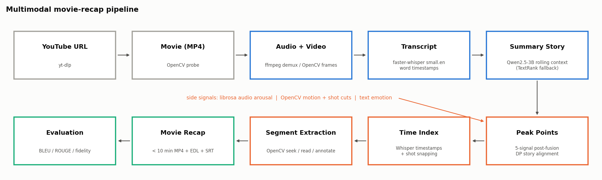
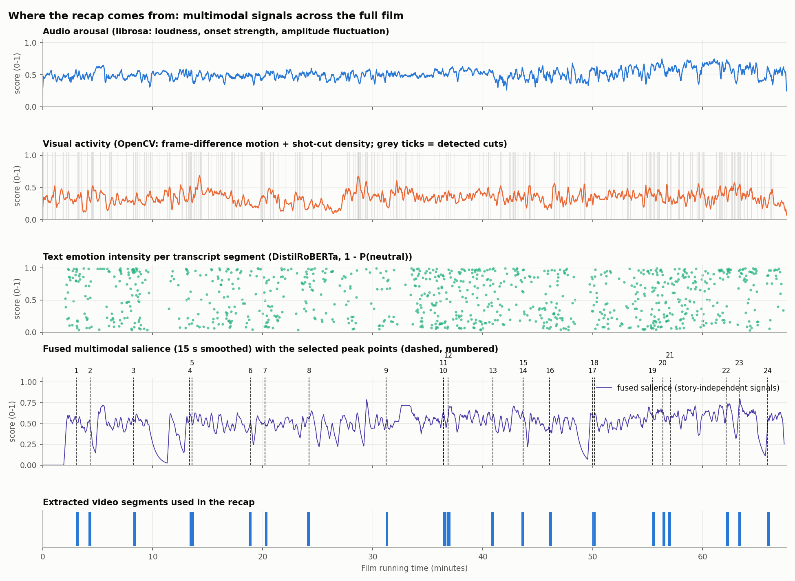

# Multimodal Movie Recap: YouTube film to a recap under 10 minutes

AI11 · Module 8 · Multimodal AI Systems: Speech, Text, and Conversational Agents · Assignment 1

A complete, CPU-only pipeline that takes a YouTube movie, processes its **video, audio and text**,
writes a **summary story**, identifies the **peak points** of the plot with their **time indices**,
extracts the matching **video segments with OpenCV**, and assembles a narrated **movie recap of less
than 10 minutes**. The recap is then evaluated with **BLEU** (plus ROUGE and a recap fidelity check).

```
YouTube Video -> Movie -> Audio + Video -> Transcript -> Summary Story -> Peak Points
             -> Time Index -> Video Segment Extraction -> Movie Recap (< 10 min) -> BLEU Evaluation
```

**Public repository:** <https://github.com/Kdk181622/multimodal-movie-recap>  
**Student:** Karthikeyan K · **Faculty:** Dr. J. B. Simha

**Explanation video:** [`docs/Explanation_Video_Karthikeyan_K.mp4`](docs/Explanation_Video_Karthikeyan_K.mp4) (see section 7b).



---

## 1. Project overview and objective

| | |
|---|---|
| **Input** | *Detour* (1945, dir. Edgar G. Ulmer), a public-domain film noir on YouTube: <https://www.youtube.com/watch?v=tap67KjjPu8> (67 min 38 s) |
| **Output** | `outputs/detour_1945/movie_recap.mp4`: an 8 min 44 s recap with chapter narration, plus the transcript, summary story, peak points, time index, edit decision list and evaluation |
| **Why this film** | Public domain, so recap clips can be shared without copyright risk. It has a strong plot and heavy voice-over narration (good for speech-to-text), and a well-known human-written plot summary exists to serve as the BLEU reference |

Objectives (from the assignment brief):
1. Implement a multimodal pipeline that processes video, audio and text.
2. Apply speech-to-text and summarisation to produce a concise summary story.
3. Identify important/peak points and map them to time indices in the original film.
4. Extract and combine the relevant segments into a recap under 10 minutes.

## 2. Proposed solution and architectural design

The design follows the session's guidance: **test each component in isolation, then integrate**
(Unix-pipe style), keep models small enough for a CPU laptop, and **fuse modalities late (post-fusion)**.

| Stage | Module | What it does | Tools / models |
|---|---|---|---|
| 1 Ingest | `recap/ingest.py` | Downloads the film (≤480p, **original English** audio track; this upload also carries auto-dubbed tracks), probes it with OpenCV | yt-dlp, OpenCV |
| 2 A/V extraction | `recap/ingest.py` | Demuxes the soundtrack to 16 kHz mono WAV (ASR) and MP3 | ffmpeg (bundled by imageio-ffmpeg) |
| 3 Speech-to-text | `recap/transcribe.py` | Timestamped transcript with word-level times, SRT export | faster-whisper `small.en` (int8, CTranslate2) |
| 4 Multimodal signals | `recap/features.py` | **Audio** arousal (RMS loudness, onset strength, amplitude fluctuation); **video** motion + HSV-histogram shot-cut detection; **text** emotion intensity | librosa, OpenCV, DistilRoBERTa emotion model |
| 5 Summary story | `recap/summarize.py` | 5-minute chunks with the story so far as rolling context. Per chunk the LLM first writes grounded **event notes** ("who - does what - to whom (quote)"), then exactly 2 sentences from them. An **editor pass** checks the whole draft against all notes. Two **deterministic checks** follow: a **key-event check** (a death or murder in the dialogue must be in the story; a missing one is added by one targeted call) and a **character-entry check** (no character named before the name is first spoken; offenders are repaired). TextRank extractive summariser as fallback/baseline | Ollama + Qwen2.5-7B-Instruct (temperature 0), sentence-transformers |
| 6 Peak points | `recap/peaks.py` | Each story sentence is aligned to the film (monotonic dynamic-programming alignment restricted to its source chunk), then the peak segment is chosen by **post-fusion of 5 signals**: semantic similarity, TextRank centrality, text emotion, audio arousal, visual activity | sentence-transformers MiniLM, NumPy |
| 7 Time index | `recap/peaks.py`, `recap/segments.py` | Whisper timestamp of the peak → clip window grown with on-topic neighbouring dialogue, snapped to detected shot cuts, kept chronological and non-overlapping, held within the duration budget | NumPy |
| 8 Segment extraction & recap | `recap/render.py` | **OpenCV** frame-accurate seeking, reading and annotation (original timecode, peak badge, film-position bar); chapter cards carry the story sentences with offline TTS narration; audio assembled sample-locked to the frames; ffmpeg only muxes/encodes | OpenCV, Pillow, pyttsx3, soundfile |
| 9 Evaluation | `recap/evaluate.py`, `recap/bleu.py` | BLEU (own implementation, cross-checked with NLTK and sacreBLEU), ROUGE, semantic similarity vs. the Wikipedia plot; 4 baselines; recap fidelity by re-transcribing the recap; text-only vs. multimodal ablation | NLTK, sacreBLEU, faster-whisper |
| 10 Report | `recap/report.py` | Timeline figure, metric charts, architecture diagram, `REPORT.md` | matplotlib |

### How the summary, peak points, time indices and segments are linked

Every story sentence carries an explicit chain, saved in `peaks.csv` and `recap_edl.csv`:

```
story sentence  ->  source chunk (5-min time span)  ->  aligned 30 s window (DP alignment)
               ->  peak transcript segment (fused score)  ->  Whisper timestamp (time index)
               ->  clip [start, end] in the film  ->  position [start, end] in the recap
```

In the recap itself this chain stays visible: a chapter card reads out the sentence and shows the peak
time; the clip that follows has an `ORIGINAL hh:mm:ss` timecode badge, a `PEAK n` badge, a white flash
at the exact peak moment, and a bar along the bottom showing where in the film the clip comes from.

## 3. Repository layout

```
Movie_Recap_Multimodal/
├── run_pipeline.py          # CLI entry point
├── config.yaml              # every tunable parameter (models, weights, budget)
├── requirements.txt
├── recap/                   # pipeline package (one module per stage)
├── tests/                   # component tests on a synthetic movie with known ground truth
├── notebooks/Movie_Recap_Walkthrough.ipynb   # executed stage-by-stage walkthrough
├── data/reference/          # Wikipedia plot used as the BLEU reference (+ licence note)
├── data/input/              # the downloaded film (not committed; fetched automatically)
├── outputs/detour_1945/     # all generated artefacts, incl. movie_recap.mp4 and REPORT.md
└── docs/                    # architecture diagram, presentation deck, speaker script
```

## 4. Setup

Tested on Windows 11, Python 3.10 (also 3.12-3.14), CPU only (8 cores, 24 GB RAM). No GPU or system ffmpeg is needed.

```bash
python -m venv .venv
.venv\Scripts\activate          # Linux/macOS: source .venv/bin/activate
pip install -r requirements.txt

# Local LLM for the summary story (optional: without it the pipeline falls back to TextRank)
#   install Ollama from https://ollama.com, then:
ollama pull qwen2.5:7b      # or qwen2.5:3b for a faster, lower-quality story
```

The Whisper, sentence-transformer and emotion models download automatically on first use.
If a Hugging Face download stalls on Windows, set `HF_HUB_DISABLE_XET=1`.

## 5. Running

```bash
python run_pipeline.py                                   # full run with config.yaml (Detour, 1945)
python run_pipeline.py --url "https://www.youtube.com/watch?v=..."   # another film
python run_pipeline.py --fresh summary.json peaks.json   # recompute selected stages
python run_pipeline.py --fresh all                       # recompute everything
python -m pytest -q tests                                # 27 component tests
```

For another film, also update `input.title`, `input.cast`, `input.local_path`,
`input.reference_summary` and `output_dir` in `config.yaml`.

Slow stages cache their results as JSON in the output folder, so downstream stages can be tuned
quickly. Measured on the reference machine: download 2 min, transcription 22 min, features 2 min,
LLM summary about 33 min (Qwen2.5-7B, notes + editor + checks; about 14 min with qwen2.5:3b), peaks + rendering 4 min,
evaluation 6-18 min (the fidelity check re-transcribes every clip).

On Windows, `RUN_V2_PIPELINE.bat` runs the pipeline, the tests and the notebook in one go and writes its progress to
`outputs/experiments/run_v2_status.txt`.

## 6. Expected input and output

**Input:** a YouTube URL (or a local MP4) and, for evaluation, a human-written reference summary.

**Output** (`outputs/<film>/`):

| File | Content |
|---|---|
| `movie_recap.mp4` | the recap (< 10 min), H.264/AAC |
| `movie_recap.srt` | subtitles for the recap (narration + original-time notes) |
| `recap_edl.csv` | edit decision list: every card/clip with recap time ↔ source time |
| `transcript.json / .srt` | timestamped transcript (segment + word level) |
| `summary.json`, `summary_story.txt` | chunk summaries, story sentences and their source chunks |
| `peaks.json / .csv` | peak points with time index and every modality score |
| `clips.json` | planned video segments |
| `features_*.json` | per-second audio/visual curves, per-segment text emotion |
| `evaluation.json`, `REPORT.md` | all metrics and the written report |
| `timeline.png`, `metrics.png`, `fidelity.png` | figures |

## 7. Results

All numbers below come from `outputs/detour_1945/evaluation.json` (the full write-up is in
[`outputs/detour_1945/REPORT.md`](outputs/detour_1945/REPORT.md)).

**Recap:** 67 min 38 s film → **8 min 44 s recap** (under 10 minutes ✔, 7.7× compression), 24 peak points,
5.5 minutes of original footage plus 24 narrated chapter cards.

**Summary story vs. the human reference plot (Wikipedia)**

| System | BLEU-4 | sacreBLEU | BLEU-1 | ROUGE-L | Semantic similarity | Plot coverage |
|---|---|---|---|---|---|---|
| **Summary story (ours, Qwen2.5-7B v2)** | **0.040** | **0.035** | **0.407** | **0.191** | **0.810** | **0.56** |
| Extractive TextRank | 0.021 | 0.016 | 0.324 | 0.134 | 0.452 | 0.16 |
| Lead-N (first words) | 0.016 | 0.010 | 0.285 | 0.107 | 0.305 | 0.00 |
| Uniform segments | 0.014 | 0.007 | 0.271 | 0.124 | 0.465 | 0.08 |
| Random segments | 0.015 | 0.010 | 0.294 | 0.119 | 0.377 | 0.12 |

The story beats every baseline on every reported metric. Absolute BLEU is low for every system because
BLEU counts exact 4-word overlaps and independent summaries rarely share phrasing (brevity penalty 0.76).

**Recap fidelity** (each clip cut from the finished recap and transcribed again): mean clip BLEU
**0.73** (median 0.77, above the 0.7 threshold from class), peak-line hit rate **92%**, narration
BLEU 0.97. This verifies the summary → peak → time index → segment chain end to end.

**Ablation:** multimodal fusion moved 13 of 24 peaks (mean 12 s) compared with text-only selection,
raising the emotion intensity of the chosen moments from 0.50 to 0.77 at a semantic cost (0.87 → 0.75).

**Model selection** ([`outputs/experiments/SUMMARY_EXPERIMENTS.md`](outputs/experiments/SUMMARY_EXPERIMENTS.md)):

| Run | Summariser | Words | BLEU-4 | ROUGE-L | Semantic | Plot coverage | Main problem |
|---|---|---|---|---|---|---|---|
| E | 7B, rolling context | 315 | 0.030 | 0.181 | 0.856 | 0.56 | Vera named 14 min early; police threat reversed; no climax |
| v2b | 7B, notes + editor + checks | 213 | 0.020 | 0.189 | 0.851 | 0.52 | 4 chunks lost their story text; too short (brevity penalty 0.25) |
| v2c | + story fallback, 2 sentences per chunk | 405 | 0.041 | 0.192 | 0.838 | 0.64 | Added sentences in first person, partly invented |
| **Final** | + strict key-event prompt and first-person guard | 410 | **0.040** | **0.191** | 0.810 | 0.56 | 3 role errors left (no speaker labels) |

The final version was chosen because it is the only one with a correct climax and no invented events; v2c's higher
plot coverage came with invented details ("in a fit of rage, on the roadside").



## 7b. Presentation material

- `docs/Movie_Recap_Presentation.pptx`: 15-slide deck covering all required topics, with speaker notes and a
  42 s recap excerpt embedded in slide 11 (built by `docs/build_deck.js`)
- `docs/Speaker_Script.docx`: word-for-word narration plus recording steps, about 16.5 minutes including the
  excerpt (built by `docs/make_speaker_script.py` from `docs/speaker_notes.json`)
- `notebooks/Movie_Recap_Walkthrough.ipynb`: executed stage-by-stage walkthrough for a live demo
- `docs/Explanation_Video_Karthikeyan_K.mp4`: **project explanation video (16 min 11 s, inside the required 8-20 minutes)**, Full HD, Indian-English neural voice.
  It walks through all 15 slides: problem statement, objectives, proposed solution, architecture, technologies,
  implementation, summary and peak-point identification, timestamp mapping and segment extraction, the final recap
  (with the recap excerpt played full screen), evaluation results, and conclusions. Built by
  `docs/make_explanation_video.py` from the slide images and `docs/speaker_notes.json`.

## 8. Testing

`tests/` checks every component on a synthetic 8-second movie with known structure (a hard cut at
4 s, a loud burst at 5–6 s) and on hand-made transcripts:
BLEU against textbook values and NLTK · audio extraction · shot-cut detection · audio arousal peak ·
TextRank · notes/editor parsing · key-event check · character-entry check · monotonic alignment · peak fusion · clip budgeting (order, no overlap, peak contained) ·
OpenCV frame-accurate seeking · recap A/V sync · TTS → Whisper round trip.

## 9. Limitations and future work

- A 7-billion-parameter LLM on a CPU still makes role errors (3 of 24 sentences: an anecdote taken as a current
  event, Vera called "Haskell" once, and who accuses whom reversed twice) because the transcript has no speaker
  labels. The key-event and character-entry checks remove the errors they can detect; speaker diarisation would
  address the rest.
- BLEU against an independently written plot summary is naturally low for any abstractive summary
  (different wording for the same events); semantic similarity and the baselines give the fairer picture.
- Visual features are low-level (motion, cuts). A vision-language model (e.g. CLIP) could match story
  sentences to frames directly, which would help scenes without dialogue.
- Recap narration uses the offline OS voice; a neural TTS would sound more natural.
- With 24 story sentences, two sentences of one chunk sometimes choose neighbouring peaks, giving two short clips of
  one scene; merging same-scene peaks into one longer clip is a planned improvement.

## 10. References

- Radford et al., *Robust Speech Recognition via Large-Scale Weak Supervision* (Whisper), 2022; faster-whisper / CTranslate2.
- Papineni et al., *BLEU: a Method for Automatic Evaluation of Machine Translation*, ACL 2002.
- Lin, *ROUGE: A Package for Automatic Evaluation of Summaries*, 2004. Lin & Och, *ORANGE* (BLEU smoothing), COLING 2004.
- Mihalcea & Tarau, *TextRank: Bringing Order into Texts*, EMNLP 2004.
- Reimers & Gurevych, *Sentence-BERT*, EMNLP 2019 (`all-MiniLM-L6-v2`).
- Hartmann, *Emotion English DistilRoBERTa-base*, Hugging Face, 2022.
- Qwen Team, *Qwen2.5 Technical Report*, 2024. Ollama.
- McFee et al., *librosa*, SciPy 2015. OpenCV. yt-dlp. NLTK. sacreBLEU (Post, 2018).
- Reference summary: Wikipedia, "Detour (1945 film)", Plot section, CC BY-SA 4.0 (see `data/reference/SOURCE.md`).
- Film: *Detour* (1945), Producers Releasing Corporation, public domain.
- Course material: AI11 Module 8, Day 4 class notes (Dr. J. B. Simha).
