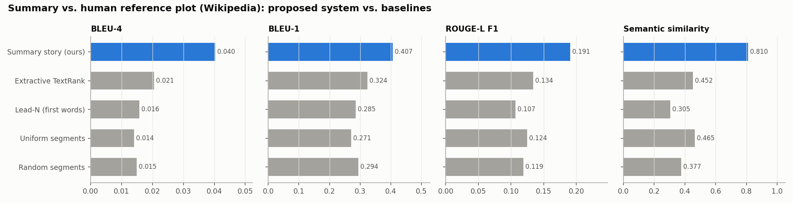
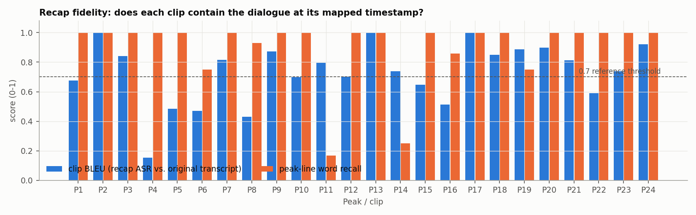

# Movie Recap Report - Detour (1945)

Source: https://www.youtube.com/watch?v=tap67KjjPu8  
Film length: 01:07:38 (640x480 @ 29.97 fps)  
Recap length: **00:08:44** (524.3 s, under 10 minutes: **True**, compression 7.74x)

## 1. Transcript

faster-whisper `small.en` produced 946 timestamped segments (8418 words) in 1310.2 s on CPU. Full text: `transcript.srt` / `transcript.json`.

## 2. Summary story

Generated by `ollama:qwen2.5:7b` from 13 transcript chunks (rolling context, 1-2 sentences per chunk).

> Al complains about the music at his club, causing a conflict with the DJ. Al reflects on his time at the old break at Dawn Club, missing his former life and his girlfriend Sue. Al loses his appetite at the club, while Sue decides to leave for Hollywood. Al continues his journey by thumbing rides, hoping to reach Los Angeles despite the risks. Al calls his girlfriend Sue, promising to see her soon. Al throws a hitchhiker out of his car, then reminisces about his father's sabers, hinting at a violent past. Al feels optimistic about reaching Hollywood soon. Al hides Haskell's body in a gully, contemplating the consequences of his actions, fearing he might be identified by the police. Al drives cautiously, suspecting he is being followed, and interacts with an officer who confirms his identity as Charles Haskell, Jr. Al finds $768 and a letter that reveals Haskell's deceitful nature, leading him to decide to investigate further. Al and Vera are in the car together, and Al realizes Vera is Haskell, making him feel trapped and cornered. The situation is worsening for Al as he must now deal with Haskell's presence. Al believes Vera might have killed the man they picked up, though she denies it. Al and Vera argue in a Hollywood apartment about selling the car to avoid suspicion, with Al reluctantly agreeing to share the profits. Al suspects Vera might have accidentally caused the man's death by pushing him out of the car. Al cleans himself in the bathtub, feeling refreshed but still trapped with Vera. They argue about their predicament, with Al maintaining his innocence. Vera threatens Al, forcing him to stay. Al argues with Vera over the car's price. Al and Vera argue over the car, Al decides to keep it, proposes a plan to impersonate Haskell, and threatens Vera. Al stands firm on his decision, while Vera becomes increasingly desperate. Al and Vera argue intensely about Vera's plan to call the police and Al's decision to keep the car, leading to a heated confrontation in the room. Vera's threats to involve the police escalate the tension, while Al's insistence on keeping the car despite the risks further strains their relationship. Al kills Vera accidentally, and now the police suspect him of her murder. Al contemplates his next move, planning to destroy evidence and flee Bakersfield to avoid being recognized, while hoping fate will spare him by not stopping him on the road.

## 3. Summary -> peak points -> time index -> video segments

| # | Story sentence | Peak time | Peak line (transcript) | Clip in film | Clip in recap | Emotion | Fused |
|---|---|---|---|---|---|---|---|
| 1 | Al complains about the music at his club, causing a conflict with the DJ. | 00:03:02 | That music, it stinks! | 00:03:00-00:03:16 | 00:00:11-00:00:27 | disgust | 0.7276 |
| 2 | Al reflects on his time at the old break at Dawn Club, missing his former life and his girlfriend Sue. | 00:04:19 | Sue, she was always selling it too. | 00:04:10-00:04:26 | 00:00:35-00:00:50 | disgust | 0.6129 |
| 3 | Al loses his appetite at the club, while Sue decides to leave for Hollywood. | 00:08:13 | Al, look, I love you. You know I do. | 00:08:13-00:08:29 | 00:00:57-00:01:12 | joy | 0.7023 |
| 4 | Al continues his journey by thumbing rides, hoping to reach Los Angeles despite the risks. | 00:13:21 | you'll click no don't try to stop me just expect me train who knows train plane | 00:13:21-00:13:32 | 00:01:20-00:01:31 | neutral | 0.6295 |
| 5 | Al calls his girlfriend Sue, promising to see her soon. | 00:13:35 | and then let's get married right away huh that's the stuff that's what I've been | 00:13:32-00:13:44 | 00:01:36-00:01:49 | neutral | 0.3866 |
| 6 | Al throws a hitchhiker out of his car, then reminisces about his father's sabers, hinting at a violent past. | 00:18:54 | a door. You get me in the arm here. Pretty mean cut. | 00:18:43-00:18:59 | 00:01:57-00:02:14 | disgust | 0.5836 |
| 7 | Al feels optimistic about reaching Hollywood soon. | 00:20:12 | If I got him down on me, I'd buy a ticket to Hollywood. | 00:20:12-00:20:26 | 00:02:19-00:02:33 | neutral | 0.6463 |
| 8 | Al hides Haskell's body in a gully, contemplating the consequences of his actions, fearing he might be identified by the police. | 00:24:13 | fell out of the car why if Haskell came to which of course he couldn't even he | 00:24:00-00:24:16 | 00:02:43-00:02:59 | surprise | 0.7106 |
| 9 | Al drives cautiously, suspecting he is being followed, and interacts with an officer who confirms his identity as Charles Haskell, Jr. Al finds $768 and a letter that reveals Haskell's deceitful nature, leading him to decide to investigate further. | 00:31:12 | And then I found out from a letter Haskell was cutting around in his bag | 00:31:12-00:31:25 | 00:03:17-00:03:31 | surprise | 0.7507 |
| 10 | Al and Vera are in the car together, and Al realizes Vera is Haskell, making him feel trapped and cornered. | 00:36:23 | He was sitting right there in the car laughing like mad while he haunted me. | 00:36:23-00:36:32 | 00:03:39-00:03:48 | fear | 0.6122 |
| 11 | The situation is worsening for Al as he must now deal with Haskell's presence. | 00:36:26 | There was nothing I could say. | 00:36:32-00:36:41 | 00:03:54-00:04:04 | sadness | 0.5326 |
| 12 | Al believes Vera might have killed the man they picked up, though she denies it. | 00:36:50 | I told her everything, but she didn't believe my story. | 00:36:47-00:37:04 | 00:04:10-00:04:26 | anger | 0.6645 |
| 13 | Al and Vera argue in a Hollywood apartment about selling the car to avoid suspicion, with Al reluctantly agreeing to share the profits. | 00:40:55 | A dealer might think something was funny | 00:40:44-00:41:00 | 00:04:36-00:04:51 | surprise | 0.7585 |
| 14 | Al suspects Vera might have accidentally caused the man's death by pushing him out of the car. | 00:43:39 | Maybe he was dead before he fell out of the car. I don't know. | 00:43:31-00:43:38 | 00:04:58-00:05:05 | neutral | 0.7424 |
| 15 | Al cleans himself in the bathtub, feeling refreshed but still trapped with Vera. | 00:43:41 | Sure, Sherry, died of old age. | 00:43:38-00:43:45 | 00:05:12-00:05:19 | sadness | 0.6928 |
| 16 | They argue about their predicament, with Al maintaining his innocence. | 00:46:06 | What got us on this subject anyway? | 00:46:01-00:46:17 | 00:05:25-00:05:41 | surprise | 0.5945 |
| 17 | Vera threatens Al, forcing him to stay. | 00:49:57 | But Vera, unfortunately, was just as rotten in the morning | 00:49:57-00:50:06 | 00:05:45-00:05:55 | disgust | 0.7095 |
| 18 | Al argues with Vera over the car's price. | 00:50:09 | So what? The dealers will be there all day? | 00:50:06-00:50:16 | 00:05:59-00:06:09 | surprise | 0.6788 |
| 19 | Al and Vera argue over the car, Al decides to keep it, proposes a plan to impersonate Haskell, and threatens Vera. | 00:55:25 | Oh, grow up, Vera. | 00:55:25-00:55:41 | 00:06:18-00:06:34 | neutral | 0.612 |
| 20 | Al stands firm on his decision, while Vera becomes increasingly desperate. | 00:56:22 | Vera, please, you're talking too loud. | 00:56:21-00:56:37 | 00:06:40-00:06:57 | disgust | 0.7437 |
| 21 | Al and Vera argue intensely about Vera's plan to call the police and Al's decision to keep the car, leading to a heated confrontation in the room. | 00:57:03 | This was a death watch for Vera. | 00:56:49-00:57:08 | 00:07:07-00:07:25 | fear | 0.7185 |
| 22 | Vera's threats to involve the police escalate the tension, while Al's insistence on keeping the car despite the risks further strains their relationship. | 01:02:08 | Please open the door. Vera, open the door. | 01:02:07-01:02:24 | 00:07:35-00:07:51 | neutral | 0.7645 |
| 23 | Al kills Vera accidentally, and now the police suspect him of her murder. | 01:03:19 | And now, after killing Vera without really meaning to do it, | 01:03:15-01:03:30 | 00:07:57-00:08:12 | anger | 0.8503 |
| 24 | Al contemplates his next move, planning to destroy evidence and flee Bakersfield to avoid being recognized, while hoping fate will spare him by not stopping him on the road. | 01:05:56 | Because Al Roberts was listed as dead and had to stay dead. | 01:05:50-01:06:05 | 00:08:24-00:08:40 | sadness | 0.709 |

Fusion weights: semantic 0.40, centrality 0.15, text_emotion 0.15, audio 0.15, visual 0.15

## 4. Evaluation

### 4.1 Summary vs. human reference (Wikipedia plot)

| System | BLEU-4 | BLEU-4 (NLTK) | sacreBLEU | BLEU-1 | ROUGE-1 | ROUGE-2 | ROUGE-L | Semantic sim. | Plot coverage | Words |
|---|---|---|---|---|---|---|---|---|---|---|
| Summary story (ours) | 0.0403 | 0.0403 | 0.0353 | 0.4066 | 0.4143 | 0.0913 | 0.1909 | 0.8097 | 0.56 | 410 |
| Extractive TextRank | 0.0205 | 0.0205 | 0.0156 | 0.3241 | 0.3187 | 0.0507 | 0.1341 | 0.4523 | 0.16 | 411 |
| Lead-N (first words) | 0.0158 | 0.0158 | 0.0096 | 0.2853 | 0.2472 | 0.0156 | 0.1069 | 0.3053 | 0.0 | 410 |
| Uniform segments | 0.0141 | 0.0141 | 0.0067 | 0.2712 | 0.2805 | 0.0317 | 0.1244 | 0.4652 | 0.08 | 376 |
| Random segments | 0.0149 | 0.0149 | 0.01 | 0.2936 | 0.2989 | 0.0242 | 0.1187 | 0.3771 | 0.12 | 410 |

### 4.2 Recap fidelity (recap re-transcribed with Whisper)

- Mean clip BLEU (recap speech vs. original transcript at the mapped timestamps): **0.7307** (median 0.7668)
- Peak-line hit rate (>= 60% of the peak line's words heard in its clip): **0.9167**
- Whole-recap BLEU (speech + narration vs. expected script): **0.8096**
- Narration intelligibility (BLEU of ASR on chapter cards vs. story sentences): 0.9665

### 4.3 Ablation: text-only vs. multimodal peak selection

| Selection | semantic | centrality | text_emotion | audio | visual |
|---|---|---|---|---|---|
| Text only (semantic + centrality) | 0.8655 | 0.6252 | 0.5006 | 0.5697 | 0.3825 |
| Multimodal fusion (proposed) | 0.7504 | 0.6557 | 0.7731 | 0.5544 | 0.4972 |

13 of 24 peaks moved when audio, visual and emotion signals were added (mean shift 12.4 s).

## 5. Output files

- `movie_recap.mp4` - final recap; `movie_recap.srt` - its subtitles; `recap_edl.csv` - edit decision list
- `transcript.json/.srt`, `summary.json`, `peaks.json/.csv`, `clips.json`, `evaluation.json`
- `features_audio.json`, `features_visual.json`, `features_text_emotion.json`
